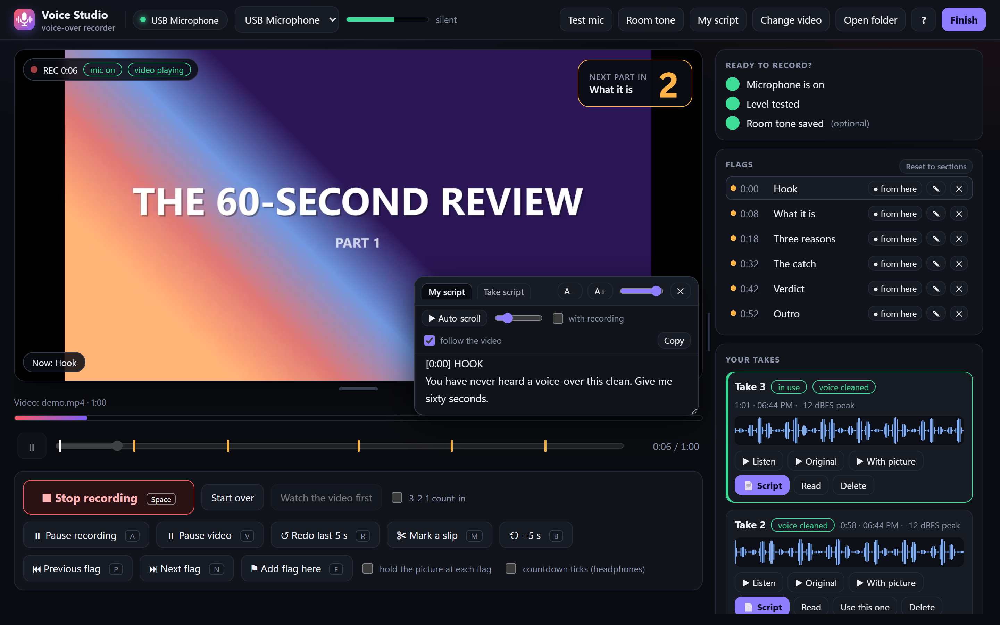
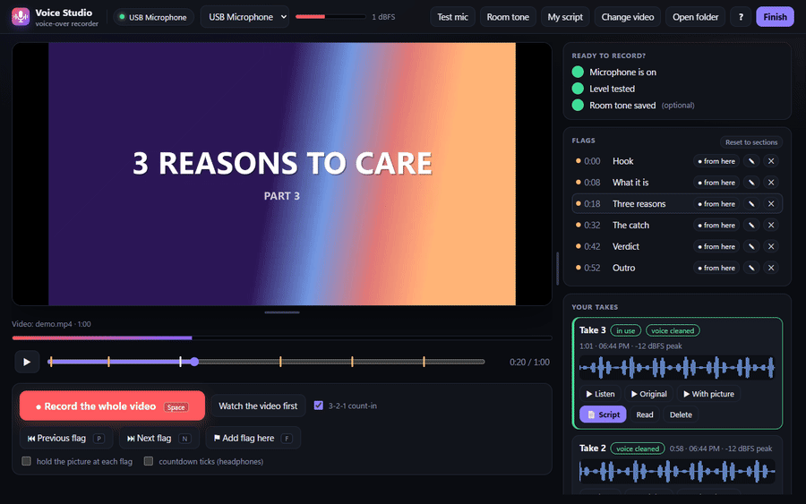
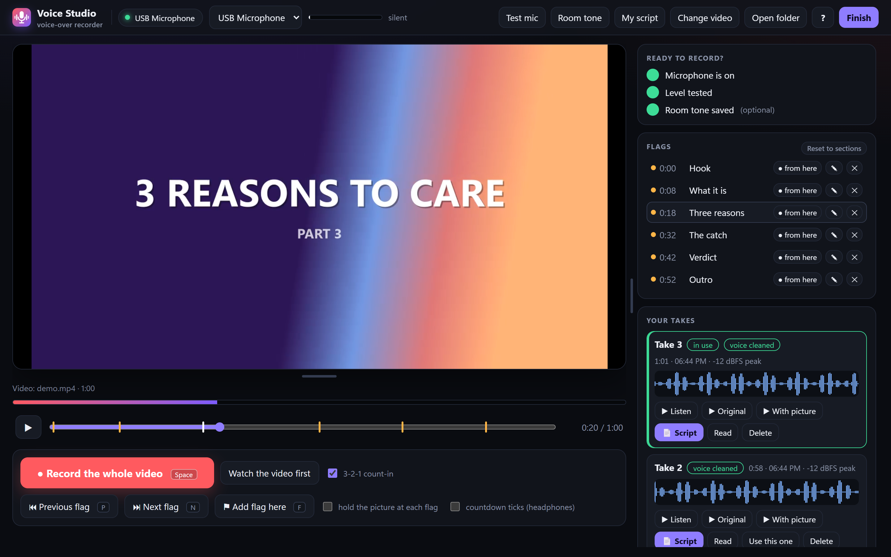
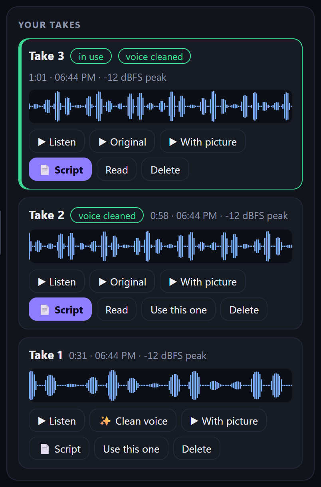
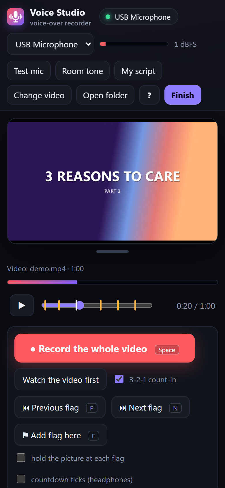

<p align="center"></p>

<h1 align="center">Voice Studio</h1>
<p align="center"><b>Record a voice-over against your video, in one take, on your own computer.</b><br>
Every slip is flagged, every take is kept, nothing leaves your machine.</p>

<p align="center">


</p>



Voice Studio plays your edit with the sound muted, and you talk over it in one go. A countdown warns you before each new part, and your script scrolls along with the picture. When you stumble, press one key: the slip is marked on the timeline, so it can be cut out later. You don't stop and start again.

When you finish, you get a clean WAV, a noise-reduced copy, a timed transcript and a `manifest.json` that tells your editor (or your automation) exactly which take to use and where the slips are.

## Contents

- [Features](#features)
- [Install](#install)
- [How to use it](#how-to-use-it)
- [Keyboard shortcuts](#keyboard-shortcuts)
- [Tips for a clean take](#tips-for-a-clean-take)
- [Settings](#settings)
- [Where your files are](#where-your-files-are)
- [Troubleshooting](#troubleshooting)
- [Security and privacy](#security-and-privacy)
- [For developers](#for-developers)

## Features

| | |
|---|---|
| **One-take recording** | Record the whole video at once, with a 3-2-1 count-in, live level meter and REC badge |
| **Slip control** | Pause everything, pause only the picture, redo the last 5 seconds, mark a slip, jump back 5 s. Every action is logged with its time |
| **Flags** | Section markers on the timeline, with a big "Next part in 3-2-1" countdown. Optionally the picture waits at each flag until you're ready |
| **Script reader** | A floating, see-through teleprompter that scrolls by itself or follows the video, and saves as you type |
| **Resizable layout** | Drag the video bigger or smaller and the controls move with it. Drag the side panel wider or narrower. Your layout is remembered |
| **Takes** | Waveform, length and peak per take. Listen, watch with the picture, pick one, delete with undo |
| **Clean voice** | One-click noise removal that keeps the voice natural. The original is never changed |
| **Transcript** | A timed script of each take (Whisper on your GPU), editable and downloadable |
| **Crash-safe** | Audio is saved to disk every 5 seconds; a crash or closed window is recoverable |
| **Projects** | Keep several videos ready and switch between them from the header |
| **Private** | Runs only on your computer. No account, no upload, no cloud |

### Make the picture as big or small as you like



There are two ways to resize:

- To change the video height, drag the bar under the video.
- To change how wide the video is next to the side panel, drag the bar between the columns.

You can also click a bar and use the arrow keys (hold Shift for bigger steps). Double-click a bar, or press Home, to reset it. Voice Studio remembers your layout for next time.

## Install

You need:
- **Python 3.9 or newer.** On Windows, get it from [python.org](https://www.python.org/downloads/) and tick "Add python.exe to PATH" during setup.
- **Chrome or Edge.**
- Optional, but recommended: **ffmpeg**, which lets you load your own videos. On Windows, run `winget install Gyan.FFmpeg`.

Then download Voice Studio. Either click **Code → Download ZIP** on this page and unzip it, or clone it:

```bash
git clone https://github.com/psparihar21/voice-studio.git
```

That's it: there is nothing else to install.

### Start it

**Windows:** double-click `scripts\start.bat`. A small window starts the studio (keep it open while you work) and the studio opens as its own app window.

**Any system:** open a terminal in the Voice Studio folder and run:

```bash
python -m voice_studio --open
```

The studio opens at **http://localhost:8765**. Your recordings are saved in a `VoiceStudio` folder in your home folder. To use another folder, add `--data "D:\My Voice-overs"`.

## How to use it



### 1. Turn on your microphone

Click **Enable microphone** and allow access when the browser asks. Pick your mic from the list if you have more than one.

Then click **Test mic** and say a sentence in your normal voice. The studio tells you whether the level is good, too quiet or clipping. The **Ready to record?** card on the right ticks off each step and hides itself when you're set.

Optional: click **Room tone** and stay quiet for 10 seconds. It records the room's background noise, which helps clean the voice later.

### 2. Load your video

Click **Change video** and pick your edit (any format ffmpeg can read). The studio makes a silent preview copy. Your original file is not touched.

### 3. Add your script and flags

Click **My script** to open the script reader. Paste your script; it saves by itself. If you put a time at the start of a line, the reader jumps to that part as the video plays (**follow the video**):

```
[0:00] HOOK
You have never heard a voice-over this clean.

[0:08] WHAT IT IS
Voice Studio plays your edit with the sound off...
```

Drag the reader by its top bar, resize it from the corner, and make it see-through with the slider. **Auto-scroll** turns it into a teleprompter.

Flags mark where each part of the video starts. While the video plays, press **F** to add one. Rename it with ✎ and remove it with ✕. **N** and **P** jump between flags. Tick **hold the picture at each flag** if you want the video to wait for you at every new part.

### 4. Watch it once

Click **Watch the video first** to get a feel for the timing. You can also make the picture bigger or smaller now, so it suits how you like to read.

### 5. Record

Press **Space**, or click **Record the whole video**. After the 3-2-1, the video plays silently and you talk over it. Before each flag, a countdown in the corner tells you the next part is coming.

Made a mistake? Don't stop:

| Press | What happens |
|---|---|
| **R** | Redo the last 5 seconds. The picture jumps back, you say it again, and the slip is marked to be cut. |
| **M** | Mark a slip and keep going. |
| **A** | Pause everything (voice and picture). Drag the slider back to redo a part, then press **A** again. |
| **V** | Pause only the picture. Your voice keeps recording, so you can finish a thought. |
| **B** | Jump the picture back 5 seconds, without marking a slip. |

Press **Space** again to stop. To record just one section again, press **● from here** next to its flag.

### 6. Pick the best take



Every recording becomes a take. For each take you can:
- **Listen** to it, or click **With picture** to watch it in sync with the video.
- **Clean voice** removes background noise. Once it's done, **Original** lets you compare.
- **Script** downloads a timed transcript, and **Read** opens it in the script reader so you can correct it.
- **Use this one** chooses the take for the final video. **Delete** moves it to the trash, with an **Undo** right after.

### 7. Finish

Click **Finish**. Voice Studio writes `recordings/manifest.json` with the take you chose, its cleaned copy, where the picture started, every slip you marked, your flags and the room tone. Hand the folder to your editor, or point your edit script at the manifest.

### Working on several videos

Put each video in its own folder under `sets/` in your data folder, with `proxy.mp4` and optionally `my-script.txt`, `cues.json` and `video.json`. Then choose it from **Project** in the header. The takes of the project you leave are moved to `recordings_archive/<project>`, safe and untouched.

### On a small screen



On a narrow window, the layout stacks into one column, so you can keep the studio beside your editor. The video's height can still be dragged.

<br clear="right">

## Keyboard shortcuts

| Key | Action |
|---|---|
| `Space` | Start or stop recording |
| `A` | Pause or resume everything |
| `V` | Pause or resume the picture only (voice keeps recording) |
| `R` | Redo the last 5 seconds |
| `M` | Mark a slip |
| `B` | Picture back 5 seconds |
| `F` | Add a flag here |
| `N` / `P` | Next / previous flag |
| `H` | Hold at flags on or off |
| `Enter` | Continue after the picture waited at a flag |
| `K` | Play or pause (when not recording) |
| `←` / `→` | Skip 5 s (while recording, only when paused) |
| `?` | Show shortcuts and version |

Shortcuts are off while you type in the script.

## Tips for a clean take

- Keep the mic about 10 cm from your mouth, a little off to the side.
- Leave a second of silence at the start and the end.
- Aim for peaks around −12 dBFS. **Test mic** tells you where you are.
- Use headphones if you turn on the countdown ticks, so the mic doesn't hear them.
- Don't restart on every slip. Press **R** and carry on: one long take with marked slips is quicker to edit than ten short ones.

## Settings

To change settings, create a `config.json` in your data folder. Every key is optional:

```json
{
  "port": 8765,
  "language": "en",
  "vocab_prompt": "PlayStation, Rockstar, GTA 6",
  "preferred_mic": "shure|rode|fifine"
}
```

| Key | Meaning |
|---|---|
| `port` | The port the studio listens on |
| `language` | The transcript language (`en`, `hi`, …) |
| `vocab_prompt` | Names and terms the transcript should spell right |
| `preferred_mic` | Picked automatically on first start (it matches part of the mic's name) |
| `ffmpeg`, `ffprobe` | Paths, if they are not on PATH |
| `whisper_python`, `whisper_scripts` | Turns on **Script** (a Python with Whisper, and the folder with `whisper_gpu.py`) |
| `enhance_python`, `enhance_script` | Turns on **Clean voice** (a Python with DeepFilterNet, and `enhance.py`) |
| `max_video_mb`, `max_take_mb` | Upload limits |

Buttons for tools that aren't set up are hidden, so the studio works fine without them.

## Where your files are

```
VoiceStudio/
  recordings/
    full_t1.wav, full_t2.wav …   your takes (WAV, 48 kHz, mono)
    _clean/                      cleaned copies
    _transcripts/                transcripts
    _trash/                      deleted takes (Undo brings them back)
    manifest.json                written by Finish
  recordings_archive/<project>/  takes of projects you switched away from
  sets/<project>/                your projects
  proxy.mp4                      the silent preview you record against
  my-script.txt                  your script
  cues.json                      your flags
  voice-studio.log               for troubleshooting
```

Click **Open folder** in the studio to go straight there.

## Troubleshooting

| Problem | Fix |
|---|---|
| "The browser could not open the microphone" | Allow the microphone for `localhost` (click the 🔒 or 🎤 icon in the address bar), then press **Enable microphone** again. Close other apps that use the mic exclusively. |
| The meter says "click anywhere" | The browser paused audio until you interact. Click once on the page. |
| "Port 8765 is busy" | Voice Studio is already running: open http://localhost:8765. Or start it on another port with `--port 8770`. |
| **Change video** says to install ffmpeg | Install ffmpeg (`winget install Gyan.FFmpeg`), then restart the studio. |
| No **Script** or **Clean voice** buttons | Those tools aren't set up. See [Settings](#settings). |
| "Windows is still using that file" | Stop playback, then try again. |
| The studio closed while recording | Start it again. It offers to **Recover** the unsaved recording as a take. |
| The layout looks squashed | Double-click the resize bars to reset them. |

Still stuck? Look in `voice-studio.log` in your data folder.

## Security and privacy

Voice Studio is built for one person on one computer:

- It only listens on `127.0.0.1`, so other devices on your network can't reach it.
- Other websites open in your browser can't control it. It checks the address it is reached on, needs its own header and origin on every change, and closes the connection after a rejected request.
- A strict Content-Security-Policy is applied, along with `nosniff`, no framing, and same-origin resources.
- File names are validated and upload sizes capped. Saves are atomic, so a crash never leaves a half-written file.
- Deleted takes go to a trash that keeps every copy.

To report a vulnerability, see [SECURITY.md](SECURITY.md).

## For developers

The server is a small standard-library Python package (`voice_studio/`), and the web app is plain HTML, CSS and JavaScript (`voice_studio/web/`).

```bash
python -m unittest discover -s tests -v
```

The 28 tests start real servers on free ports, using stand-in transcription and cleanup scripts, so you don't need a GPU.

To regenerate the README images (needs ffmpeg and Node 22+), build the demo project, serve it, then run the screenshot script:

```bash
python scripts/make_demo.py demo
```

```bash
python -m voice_studio --data demo --port 8793
```

```bash
node scripts/screenshots.mjs http://localhost:8793 docs/images
```

More detail:
- [docs/API.md](docs/API.md): the HTTP API and the slip timeline format.
- [docs/ARCHITECTURE.md](docs/ARCHITECTURE.md): how the parts fit together.
- [docs/TESTING.md](docs/TESTING.md): the test plan, reviews and UAT results.
- [CHANGELOG.md](CHANGELOG.md).

## License

Proprietary. All rights reserved. See [LICENSE](LICENSE).
