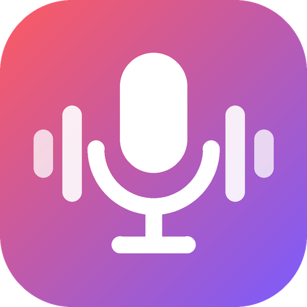
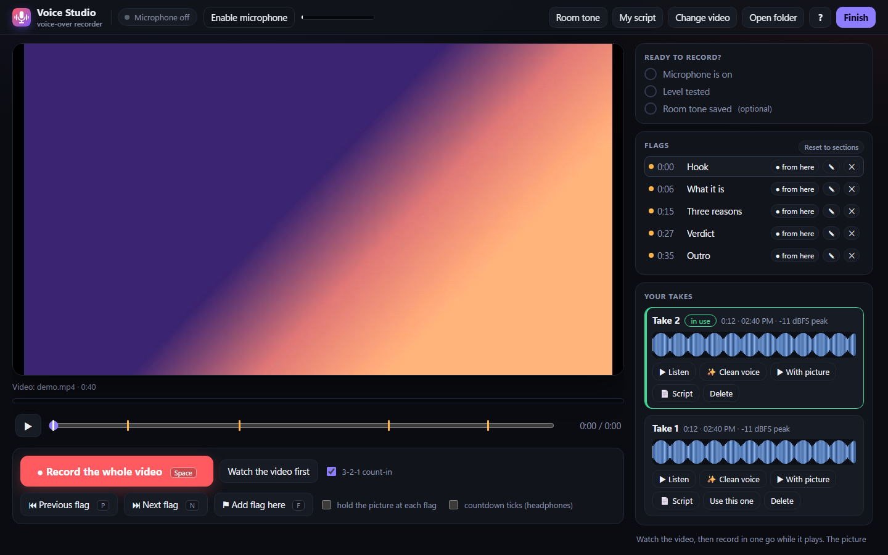

<p align="center"></p>

<h1 align="center">Voice Studio</h1>
<p align="center">Record a voice-over against a silent picture, on your own computer. Nothing leaves the machine.</p>



Voice Studio plays your edit with its sound muted, and you talk over it in one go. It marks every slip, redo and pause on the timeline, so an editor (or a script) can cut the bad bits out afterwards. Every take is kept, crash-safe, with a cleaned copy and a timed transcript beside it.

## Features

**Recording**
- One-take recording against the picture, with a 3-2-1 count-in and a live input meter.
- **Pause recording** (voice and picture), **pause video** (voice keeps going), **redo last 5 s**, **mark a slip**, **jump back 5 s**. Each event is written into the take's timeline (`segments`), so the cut can be automated.
- Crash safety: raw audio goes to disk every 5 seconds. After a crash or a closed window, the studio offers to recover it as a take. A new recording never overwrites audio that was not recovered.
- Room tone: 10 seconds of the quiet room, for noise reduction later.
- Mic check: a 4-second level test that tells you if you are too quiet or clipping.

**Flags and the picture**
- Section flags on the timeline, with a big "Next part in 3-2-1" countdown before each one. Optional countdown ticks for headphones.
- Hold the picture at each flag until you are ready (your voice keeps recording).
- Add (F), rename, delete flags, jump between them (N/P), or start recording from any flag. Reset to the original sections.
- Change the video: drop in any file and it becomes a silent 1280×720 preview (NVENC, with a CPU fallback).

**Script**
- A floating, resizable, see-through script panel that saves as you type.
- Teleprompter auto-scroll, optionally started by Record, or **follow the video**: the script jumps to the `[m:ss]` block on screen.

**Takes**
- Waveform, length, time and peak level for every take. Listen, watch with the picture, pick the one to use, delete with undo.
- **Clean voice** (DeepFilterNet, gentle mode). The original is never touched; you can A/B against it.
- **Script from the take**: a GPU Whisper transcript with times, plain text, and the original script, editable and downloadable.
- **Finish** writes `recordings/manifest.json` with the chosen take, its cleaned copy, offset, slip timeline, flags and room tone, ready for an edit pipeline.

**Projects**
- Keep several projects in `sets/` and switch between them from the header. The current takes are archived in `recordings_archive/<project>`, never overwritten.

Every action has a keyboard shortcut. Press `?` in the app for the list.

## Requirements

- Windows 10/11 (macOS and Linux run the core studio; "Open folder" is Windows-only).
- Python 3.9 or newer. The server uses the standard library only.
- Chrome or Edge (microphone access, AudioWorklet).
- Optional tools, each switching on one feature. The app hides a feature whose tool is missing:

| Feature | Needs |
|---|---|
| Change video | `ffmpeg` and `ffprobe` on PATH |
| Script from a take | A Python with Whisper and `whisper_gpu.py` / `romanize.py` (set `whisper_python`, `whisper_scripts`) |
| Clean voice | A Python with DeepFilterNet and `enhance.py` (set `enhance_python`, `enhance_script`) |

## Quick start

```bash
git clone https://github.com/psparihar21/voice-studio.git
```

```bash
cd voice-studio
```

```bash
python -m voice_studio --open
```

The studio opens at http://localhost:8765. Your takes go to `%USERPROFILE%\VoiceStudio` unless you pass `--data <folder>` or set `VOICE_STUDIO_DATA`.

On Windows, `scripts\start.bat` starts the server and opens the studio as an app window. Set `VOICE_STUDIO_PYTHON`, `VOICE_STUDIO_DATA` and `VOICE_STUDIO_PORT` before calling it to change the Python, data folder or port.

## Configuration

Put a `config.json` in the data folder. Every key is optional:

```json
{
  "port": 8765,
  "language": "hi",
  "vocab_prompt": "PlayStation, Rockstar, GTA 6",
  "preferred_mic": "fifine|shure",
  "ffmpeg": "ffmpeg",
  "whisper_python": "C:/path/to/whisper/python.exe",
  "whisper_scripts": "C:/path/to/scripts",
  "enhance_python": "C:/path/to/python.exe",
  "enhance_script": "C:/path/to/enhance.py",
  "max_video_mb": 8192,
  "max_take_mb": 2048
}
```

`host` may only be `127.0.0.1` or `localhost`. The studio refuses to listen on the network.

## Data folder

```
<data>/
  proxy.mp4, video.json      the picture you record against
  cues.json, cues-seed.json  flags per video, and the originals for "Reset to sections"
  my-script.txt              your script
  config.json                optional settings
  sets/<project>/            proxy.mp4, my-script.txt, cues.json, video.json per project
  current_set.txt
  recordings/
    full_t<N>.wav            your takes (16-bit mono, 48 kHz)
    meta.json                length, offset, peak, slip timeline per take, and the chosen take
    _clean/                  cleaned copies
    _transcripts/            transcripts
    _trash/                  deleted takes (restorable)
    _roomtone.wav
    manifest.json            written by Finish
  recordings_archive/<project>/
  voice-studio.log
```

Version 1 folders work as they are; no migration is needed.

Switch projects from the command line:

```bash
python -m voice_studio switch <project> --data <folder>
```

## Security

The studio is built for one person on one computer:

- It listens on `127.0.0.1` only.
- It refuses requests whose `Host` is not localhost, which blocks DNS rebinding.
- Every POST needs the app's own header and a same-origin `Origin`. A failed check closes the connection, so a smuggled second request is never read.
- A strict Content-Security-Policy (`script-src 'self'`) is set, along with `nosniff`, `frame-ancestors 'none'` and `Cross-Origin-Resource-Policy: same-origin`.
- File names are matched against fixed patterns and never used as raw paths. Body sizes are capped before anything is read.
- JSON and text are written atomically, and deleted takes go to a trash that keeps every copy.

See [SECURITY.md](SECURITY.md) to report a problem.

## Development

```bash
python -m unittest discover -s tests -v
```

The suite starts real servers on free ports, with stand-in Whisper and cleanup scripts, so no GPU is needed. See [docs/TESTING.md](docs/TESTING.md) for the test plan and UAT results, [docs/API.md](docs/API.md) for the HTTP API, and [docs/ARCHITECTURE.md](docs/ARCHITECTURE.md) for how the parts fit.

Regenerate the icon (needs Pillow and numpy):

```bash
python scripts/make_icon.py
```

## License

Proprietary. All rights reserved. See [LICENSE](LICENSE).
